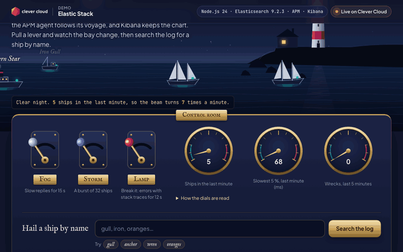
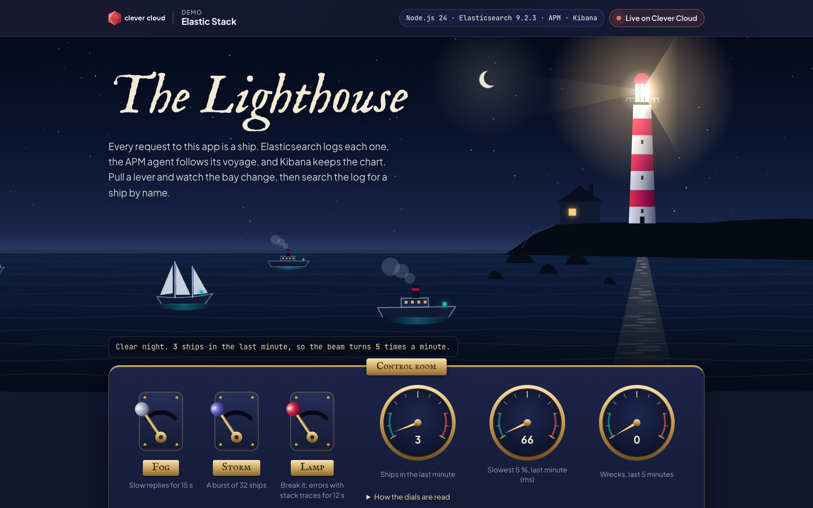
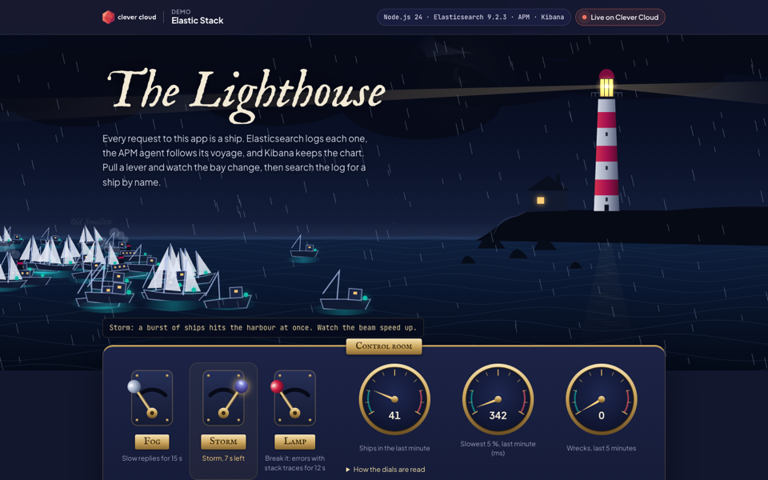
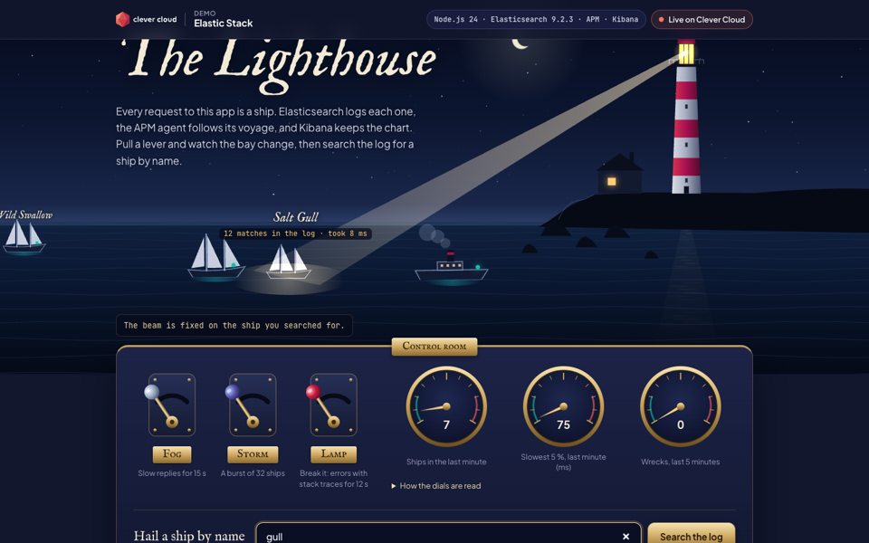
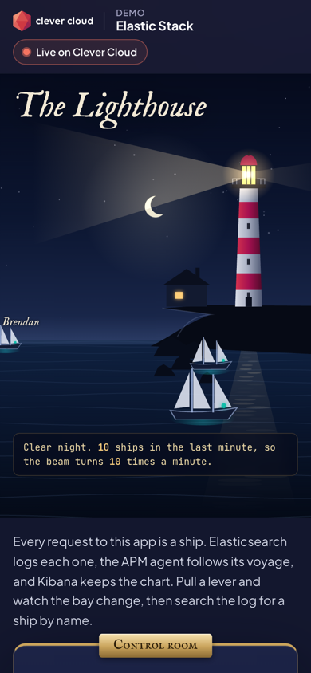

# The Lighthouse: Elastic Stack on Clever Cloud

> A lighthouse on a Breton headland, at night. Every request to the app is a ship crossing the bay: **Elasticsearch** logs each one as a JSON document, the **Elastic APM** agent follows its voyage, and **Kibana** keeps the chart. Brass levers in the control room roll in the fog (slow replies), raise a storm (a burst of traffic) or break the lamp (errors with stack traces). The beam turns faster as traffic grows, because its speed comes from an Elasticsearch aggregation. Hail a ship by name and the beam swings onto it, while the logbook shows the exact query, its hits and the time Elasticsearch took. Node.js 24 and Express 5, deployed on Clever Cloud with the Elastic Stack add-on, dressed in the Clever Brand Kit.





**Run it yourself.** A live copy runs at <https://app-4fde7f56-26fc-4b55-b614-e62e66da00fe.cleverapps.io/> (redeployed on 2026-11-10; it may be stopped between demos). The steps in [Deploy on Clever Cloud](#deploy-on-clever-cloud) recreate it from scratch in about 20 minutes, most of it waiting for Elasticsearch, Kibana and the APM server to be provisioned.

**Get certified.** This demo runs on Clever Cloud. To deploy your own apps the same way, get certified at the [Clever Cloud Academy](https://academy.clever.cloud/).

| Storm lever | Searchlight on a ship | Phone |
|---|---|---|
|  |  |  |

---

## What the Elastic Stack does in the demo

| On the page | Elastic feature | What happens |
|---|---|---|
| A ship crosses the bay | Elasticsearch, `POST /lighthouse-ships/_doc` | One request = one ship = one JSON document with ECS fields (`@timestamp`, `log.level`, `http.response.status_code`, `trace.id`…). The logbook tape shows each document as it is written. |
| **Hail a ship by name** | Full-text search | `search_as_you_type` on the ship name ("gul" finds "Morning Gull"), fuzziness for typos, a highlight and a `terms` aggregation. The logbook prints the query, the hits and `took`. The beam swings onto the ship. |
| The dials and the beam | Aggregations | One search every 4 s: the 12 latest ships, the count and the 95th percentile of the last minute, the outcomes of the last 5 minutes. The beam turns from 3 to 30 times a minute with the count. |
| **Fog** lever | APM span | For 15 s, each ship waits 0.9 to 2.6 s in a custom span named *Hold in the fog*. The latency shows in APM, and on the p95 dial. |
| **Storm** lever | APM throughput | 32 ships in a few seconds, 4 at a time: the throughput chart and the beam both speed up. |
| **Lamp** lever | Errors | For 12 s, the app throws a `LampError` from a few frames deep: HTTP 500, `apm.captureError()`, and a wreck document at level `error` with its stack trace and its `trace.id`. |
| Chart room | Clever Cloud log drain | The app prints one JSON line per ship on stdout. A Clever Cloud drain ships these lines to `lighthouse-drain-YYYY-MM-DD`, with no code. The page shows the count and the latest drained line. |
| Harbour log | Shared index | The latest ships from every visitor, read from the same index. |

All Elasticsearch calls live in [`src/elastic.js`](src/elastic.js). Each one returns the request it ran (method, path, body) next to its result, which is how the page can show it.

At startup the app creates an index template (1 shard, 0 replica, explicit mapping, priority above the add-on's default `cc_singlenode_template`, as the [Clever doc](https://www.clever.cloud/developers/doc/deploy/databases/elastic/#create-an-index-on-elasticsearch) asks), the `lighthouse-ships` index, and 48 seed ships with fixed ids, so the first screen is never empty and a restart adds nothing.

**If the app is up before Elasticsearch.** At a first deployment the app can start before the add-on answers. It listens at once (`/` and `/health` answer 200), retries the setup with a growing delay (1 s, 2 s, 4 s… capped at 30 s) and, until the template, the index and the seed ships are in place, answers 503 with a message on every `/api` route that needs Elasticsearch: no ship is written before the template exists. `GET /health` and `GET /api/state` show the phase (`preparing`, then `ready`), and so does the page. If `lighthouse-ships` already exists with a mapping that did not come from the template (`outcome` as `text`, the cause of a `fielddata` error), the phase is `bad-mapping` and the message names the fields: delete the index (`DELETE /lighthouse-ships` in Kibana Dev Tools) and the app recreates it within 30 s, with no restart.

---

## Open Kibana and APM

Kibana and the APM server are options of the Elastic Stack add-on, chosen when it is created. Kibana signs you in with your Clever Cloud account: every member of the organisation that owns the add-on can open it.

1. Open the add-on in the [Console](https://console.clever-cloud.com/) and follow its Kibana link, or use the links in the page's chart room (they are built from `ES_ADDON_KIBANA_HOST`). Kibana redirects to the Clever Cloud sign-in: sign in with an account that is a member of the organisation owning the add-on. There is no Kibana password to create.
2. **Ship log:** Discover. Create a data view on `lighthouse-ships*` with `@timestamp` as the time field, or switch Discover to ES|QL and run `FROM lighthouse-ships | SORT @timestamp DESC`. Filter `outcome: wrecked` to read the stack traces. The drained stdout lines are in `lighthouse-drain-*` (time field `date`).
3. **APM:** Observability, APM, Services, `the-lighthouse`. Each `POST /api/ships` is a transaction with its *Hold in the fog* or *Cross the bay* span and the Elasticsearch call inside. Labels carry the ship name, the weather and the outcome. The "trace" links in the logbook open one voyage directly (`/app/apm/link-to/trace/<trace.id>`).

---

## Deploy on Clever Cloud

You need [clever-tools](https://www.clever.cloud/developers/doc/cli/) (`clever login` done) and the ID of the organisation that will own the resources (`orga_…`, shown in the Console). Run the commands from the repo root: `clever create` links the folder to the new app.

```bash
# 1. The app and its size
clever create --type node demo-elastic --org <org_id> --region par
clever scale --min-flavor nano --max-flavor XS --min-instances 1 --max-instances 2
clever scale --build-flavor M

# 2. The Elastic Stack (plan xs, version 9, with Kibana and APM, encrypted at rest), linked to the app
clever addon create es-addon demo-elastic-es --plan xs --addon-version 9 --option kibana=true --option apm=true --option encryption=true --org <org_id> --region par
clever service link-addon demo-elastic-es

# 3. Variables
clever env set NODE_ENV production
clever env set CC_HEALTH_CHECK_PATH /health

# 4. Deploy
clever deploy
clever open
```

There is no secret to generate and no setup script: the linked add-on injects the `ES_ADDON_*` variables below, and at its first start the app creates the index template, the `lighthouse-ships` index and the seed ships, and retries until Elasticsearch answers (see above). `GET /health` shows `"setup": "ready"` once this is done, and `GET /health/deep` reports the cluster health.

Kibana and the APM server appear in the organisation as two applications named `Kibana - addon_…` and `APM - addon_…`, plus a `Backups` Cellar add-on for the daily snapshots. Provisioning takes a few minutes. To sign in to Kibana, see [Open Kibana and APM](#open-kibana-and-apm).

**Log drain (optional, no code).** Read the three add-on values in the Console (add-on, Environment variables) and create the drain on the app, without writing them to any file:

```bash
clever drain create elasticsearch "https://<ES_ADDON_HOST>/_bulk" --index-prefix lighthouse-drain --username <ES_ADDON_USER> --password <ES_ADDON_PASSWORD>
```

Demo sizing: `nano` to `XS`, 1 to 2 instances, dedicated `M` build.

### Recreate the stack

The add-on and its Kibana and APM applications can be deleted after a demo. To rebuild everything, run the commands above from a clone of this repo (if the app still exists, `clever link <app-id>` and skip `clever create`), then the drain command. The index template, the index and the seed ships are created by the app at its first start.

### Variables

| Variable | Set by | Role |
|---|---|---|
| `ES_ADDON_HOST`, `ES_ADDON_USER`, `ES_ADDON_PASSWORD` | the add-on (linked) | Elasticsearch client ([`src/elastic.js`](src/elastic.js)) |
| `ES_ADDON_APM_HOST`, `ES_ADDON_APM_AUTH_TOKEN` | the add-on, APM option | Elastic APM agent ([`src/apm.js`](src/apm.js)); the agent stays off when they are missing |
| `ES_ADDON_KIBANA_HOST` | the add-on, Kibana option | links to Discover and APM in the page |
| `NODE_ENV` | you | `production`, as the [Node.js runtime doc](https://www.clever.cloud/developers/doc/deploy/applications/nodejs/) asks |
| `CC_HEALTH_CHECK_PATH` | you | `/health`: the deployment is validated without touching the add-on |

Node.js 24 comes from `engines.node` in `package.json`. The "Running on Clever Cloud" panel shows `CC_APP_NAME`, `APP_ID`, `INSTANCE_NUMBER`, `INSTANCE_TYPE`, `CC_PRETTY_INSTANCE_NAME`, `CC_COMMIT_ID` (short) and `CC_DEPLOYMENT_ID`, and nothing else.

### Cost (zone `par`, November 2026 prices)

| Resource | Size | Price |
|---|---|---|
| Elasticsearch | plan `xs` (1 node, 1 GB RAM, 10 GB disk, dedicated) | 19 € / month |
| Kibana | application, flavor S | about 32 € / month (0.0444 € / hour) |
| APM server | application, flavor XS | about 16 € / month (0.0222 € / hour) |
| The demo app | nano, up to 2 × XS | from 6 € / month |
| Backups | Cellar, daily snapshots | storage used |
| **Total** | | **about 73 € / month**, plus the backup storage |

---

## Routes

| Route | What it does |
|---|---|
| `GET /` | the page |
| `POST /api/ships` | a ship: `{"weather": "clear" \| "fog" \| "storm", "lamp": "ok" \| "broken"}`. 201 with the document and the index request, or 500 for a wreck. 503 while the index template and the seed ships are not in place |
| `GET /api/ships/:id` | read one ship back from Elasticsearch |
| `GET /api/ships/search?q=gull` | the full-text search, with its query, `took`, hits and highlights |
| `GET /api/harbour` | the dials: latest ships and aggregations |
| `GET /api/drain` | count and latest line of the drained stdout |
| `GET /api/state` | platform variables, Kibana links and the setup phase |
| `GET /health` | 200, never touches the add-on; `setup` is `preparing`, `bad-mapping`, `ready` or `unconfigured` |
| `GET /health/deep` | cluster health and version, 503 if Elasticsearch does not answer |

A small per-instance limit (40 ships a second) answers 429 beyond it, so a public URL cannot flood the index. The page stops its background traffic after 10 minutes without interaction, and while the tab is hidden.

---

## Notes from the build

- **Single node, zero replica.** The APM option creates its data streams with one replica, which a one-node cluster can never assign: the cluster turns yellow. At startup the app adds `number_of_replicas: 0` through the `@custom` component templates Elastic provides for the APM data streams, and on their existing indices. The cluster stays green.
- **APM errors on Elasticsearch 9.** On this add-on, the APM server's `cc-apm` role can write `traces-apm*` and `metrics-apm*`, but not `logs-apm*`. The APM server logs `failed to index documents in 'logs-apm.error-default' (security_exception)`, so the APM Errors tab stays empty. Transactions, spans, failure rates and labels work. The demo keeps every `LampError` and its stack trace in its own log (`outcome: wrecked`), linked to the APM trace. The fix belongs to the platform (grant `logs-apm*` to `cc-apm`).

---

## Local development

```bash
npm install
npm test                 # 20 tests, an in-memory stand-in replaces Elasticsearch
PORT=8400 npm start      # http://localhost:8400
```

Without `ES_ADDON_*` variables the page loads and the API answers 503 with what to do. To run against a real add-on, export `ES_ADDON_HOST`, `ES_ADDON_USER`, `ES_ADDON_PASSWORD` (and the two APM variables) in your shell before `npm start`.

## Project structure

```
src/apm.js               → starts the Elastic APM agent (first line of server.js)
src/server.js            → Express routes, health checks, the ship route with its fog span and lamp error
src/elastic.js           → every Elasticsearch call: template, seed, index, get, search, aggregations, drain
src/ships.js             → ship names, weather, the LampError, the ECS log document, the seed fleet
public/index.html        → the page, with the Clever frame (logo, Academy badge, platform panel)
public/assets/scene.js   → the canvas: sky, sea, lighthouse, beam, ships, fog, storm
public/assets/app.js     → levers, traffic, search, logbook, dials, harbour log
public/assets/lighthouse.css → the lighthouse universe
public/assets/cc-brand.css   → Clever Brand Kit, copied as is
test/                    → node:test suites
```

## License

MIT, see [LICENSE](LICENSE). Made by [Vitiosum](https://github.com/Vitiosum).
